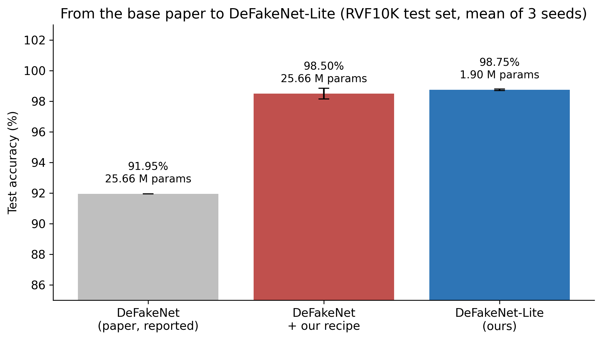
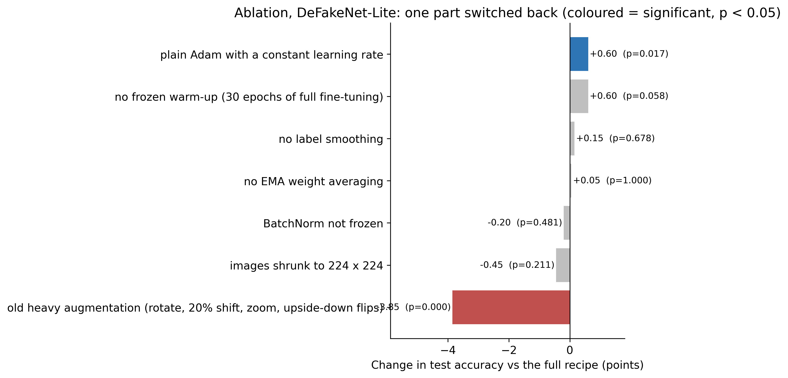
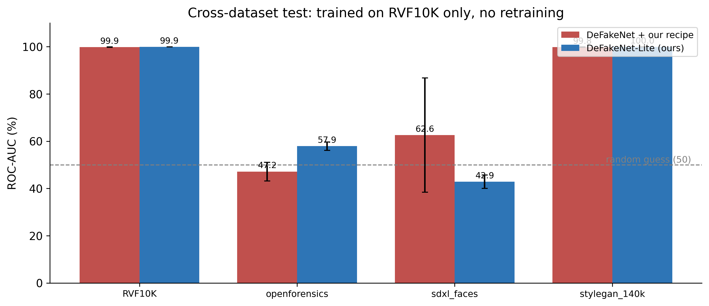

# DeFakeNet-Lite

**A Lightweight Deep Learning Model for Detecting AI-Generated Face Images**

Undergraduate thesis project, Department of Computer Science & Engineering, East Delta University, Chittagong, Bangladesh (November 2026).

* **Author:** Arman Rahman
* **Supervisor:** Md. Jamil Uddin, Lecturer

DeFakeNet-Lite tells real face photos apart from StyleGAN-generated faces. It combines a **MobileNetV3-Large (width 0.75)** backbone pre-trained on ImageNet, a compact classification head (Dropout → Dense 128 → Dropout → sigmoid) and an improved training configuration. It has **1.90 M parameters**; the DeFakeNet base model has 25.66 M.

On the RVF10K test set, DeFakeNet-Lite reaches **98.75 ± 0.05 % accuracy** (mean ± std over 3 seeds). The base paper reports 91.95 % for DeFakeNet, and DeFakeNet-Lite is 13.5× smaller and 3× faster on a CPU.



## Base paper

D. Samal, D. Nagpal, P. Agrawal, V. Madaan, and W. O. Choo, "DeFakeNet: A ResNet50V2-based deep learning model for deepfake detection and classification," *Journal of Innovative Image Processing*, vol. 7, no. 4, pp. 1356–1373, Dec. 2025, doi: [10.36548/jiip.2025.4.015](https://doi.org/10.36548/jiip.2025.4.015).

DeFakeNet fine-tunes ResNet50V2 with a Dense 1024 head. The paper reports 91.95 % accuracy, 97.64 % ROC-AUC and 83.95 % MCC on the RVF10K test set. It also argues that lightweight CNNs such as MobileNet "may struggle" on this task. This project tests that claim.

## Research questions

| | Question | Answer in this repository |
| --- | --- | --- |
| **RQ1** | Is DeFakeNet's result limited by its **architecture** or by its **training configuration**, and which part of the configuration matters? | The same DeFakeNet architecture reaches 98.50 ± 0.35 % with the improved training configuration (+6.55 points). The ablation shows the paper's heavy augmentation is the main cause (−3.85 points, McNemar p < 0.001). The paper's 0–1 pixel scaling is not a cause. |
| **RQ2** | Can a much **lighter** model keep the same accuracy? | Yes. DeFakeNet-Lite reaches 98.75 ± 0.05 %, and McNemar tests against DeFakeNet with the same training configuration find no significant difference (p = 0.07, 1.00, 0.88). DeFakeNet-Lite has 13.5× fewer parameters and 22× fewer GMACs. |
| **RQ3** | Do the detectors **generalise** to unseen datasets and other kinds of fakes, without retraining? | Only to fakes of the same kind. Unseen StyleGAN faces are detected almost perfectly (AUC 99.96 %). Diffusion faces (Stable Diffusion XL) and in-the-wild manipulations stay near chance level. This is the main limitation. |

## Results

All numbers are on the RVF10K test set (2,000 images, threshold 0.5, Real = positive class), as mean ± std over seeds 42, 1 and 2, with 40 epochs per run.

| Model | Params | Accuracy % | ROC-AUC % | PR-AUC % | F1 % | MCC % |
| --- | --- | --- | --- | --- | --- | --- |
| DeFakeNet (paper, reported, 1 run) | 25.66 M | 91.95 | 97.64 | 97.40 | 91.81 | 83.95 |
| DeFakeNet, paper-faithful reproduction (3 runs) | 25.66 M | 90.57 ± 2.18 | 96.54 ± 1.48 | 96.48 ± 1.59 | 90.60 ± 2.10 | 81.14 ± 4.36 |
| DeFakeNet + improved training | 25.66 M | 98.50 ± 0.35 | 99.85 ± 0.09 | 99.82 ± 0.16 | 98.51 ± 0.35 | 97.01 ± 0.70 |
| **DeFakeNet-Lite** | **1.90 M** | **98.75 ± 0.05** | **99.93 ± 0.01** | **99.93 ± 0.01** | **98.76 ± 0.05** | **97.50 ± 0.10** |

### Cost (measured on the same machine)

| | DeFakeNet + improved training | DeFakeNet-Lite | Ratio |
| --- | --- | --- | --- |
| Parameters (M) | 25.66 | 1.90 | 13.5× |
| GMACs per image | 4.57 | 0.21 | 22.0× |
| TFLite fp16 size (MB) | 51.32 | 3.87 | 13.3× |
| CPU latency, batch 1 (ms/image) | 73.45 | 24.18 | 3.0× |
| GPU latency, batch 32, T4 (ms/image) | 3.96 | 1.39 | 2.8× |
| Training time, 40 epochs, T4 (min) | 67.3 | 31.7 | 2.1× |

### Ablation: one part of the training configuration switched back to the paper's way

DeFakeNet-Lite, seed 42, 30 epochs. The reference is the full training configuration at 98.45 %.

| Part switched back | Accuracy % | Δ (points) | McNemar p |
| --- | --- | --- | --- |
| heavy augmentation (rotation, 20 % shift, zoom, upside-down flips) | 94.60 | **−3.85** | < 0.001 |
| images shrunk to 224 × 224 | 98.00 | −0.45 | 0.211 |
| BatchNorm trainable | 98.25 | −0.20 | 0.481 |
| no EMA weight averaging | 98.50 | +0.05 | 1.000 |
| no label smoothing | 98.60 | +0.15 | 0.678 |
| no frozen warm-up | 99.05 | +0.60 | 0.058 |
| plain Adam, constant learning rate | 99.05 | +0.60 | 0.017 |

DeFakeNet with the improved training configuration but the paper's 0–1 pixel scaling reaches 98.40 %. The −1 to 1 scaling gives 98.53 ± 0.25 %, so the scaling has no real effect.



### Cross-dataset test (trained on RVF10K only, no retraining)

The test uses 1,000 real and 1,000 fake images per set. Any image that is identical to an RVF10K image is removed. The table shows ROC-AUC %, as mean ± std over 3 seeds.

| Dataset | Kind of fake | DeFakeNet-Lite | DeFakeNet + improved training |
| --- | --- | --- | --- |
| RVF10K (test) | StyleGAN | 99.93 ± 0.01 | 99.85 ± 0.09 |
| 140k Real and Fake Faces | StyleGAN, new images | 99.96 ± 0.01 | 99.82 ± 0.09 |
| SDXL faces (CelebA-HQ reals) | Stable Diffusion XL | 42.88 ± 2.86 | 62.58 ± 24.16 |
| Deepfake and Real Images | in-the-wild manipulations | 57.94 ± 1.77 | 47.15 ± 3.94 |



## The training configuration

| Setting | DeFakeNet paper | Improved configuration |
| --- | --- | --- |
| Image size | 224 × 224 | 256 × 256 (native size) |
| Augmentation | rotation 10°, 20 % shift, zoom 20 %, shear, horizontal + vertical flips | horizontal flip + 5 % shift |
| Pixel scaling | 0 to 1 | the backbone's own pre-training scale |
| Schedule | up to 40 epochs, all layers trained from the start | 5 epochs with the backbone frozen, then 35 epochs of fine-tuning |
| Optimiser | Adam 1e-4, halved on plateau | AdamW (weight decay 1e-4); learning rate 1e-3 while frozen, then 1e-4 with a 1-epoch warm-up and cosine decay |
| Early stopping | validation loss, patience 5 | EMA validation loss, patience 8, never before epoch 15 |
| Regularisation | none | label smoothing 0.05, dropout 0.3 / 0.2, BatchNorm frozen |
| Weight averaging | none | EMA of the weights (decay 0.995); the best EMA weights by validation loss are kept |
| Mixed precision | no | float16 on GPU |

The test set is never used for training or for choosing anything.

## Repository layout

```
notebooks/
  01_defakenet_paper_faithful_reproduction.ipynb   DeFakeNet rebuilt from the paper only, 2 BatchNorm variants x 3 seeds
  02_training_ablation_and_cross_dataset.ipynb     improved training, 30 epochs: ablation, 0-1 scaling, cross-dataset test
  03_defakenet_lite_final_experiments.ipynb        final 40-epoch runs, 3 seeds, cost, cross-dataset test, all figures
results/
  01_paper_reproduction/   per-run JSON (metrics + training history), test scores (.npz), epoch logs, tables, plots
  02_ablation_30_epochs/   the 9 runs of notebook 02 reused by notebook 03 (ablation + 0-1 scaling)
  03_final_40_epochs/      per-run JSON, test scores, report plots and all result tables of notebook 03
figures/                   the 11 figures of notebook 03 (300 dpi)
```

All three notebooks are saved **with their outputs**, exactly as they ran on Kaggle (2 × NVIDIA T4, TensorFlow 2.21, Keras 3.13, Python 3.13).

## How to run

The notebooks are written for **Kaggle** (GPU T4 × 2, internet on). They also run on any machine with a CUDA GPU.

1. Create a Kaggle notebook, import the `.ipynb` file and set *Accelerator → GPU T4 × 2* and *Internet → on*.
2. Run the notebooks in this order:
   * **01** (about 2 h): standalone. It downloads RVF10K from Zenodo and installs `tf_keras` when needed.
   * **02** (about 7 h): standalone. It downloads RVF10K and the cross-dataset sets from Zenodo and Hugging Face.
   * **03** (about 5 h): needs the saved runs of notebook 02. Attach the output of notebook 02 as an input (*Add Input → Your Work → Notebooks*), or upload `results/02_ablation_30_epochs/` as a Kaggle dataset and attach it.
3. Every notebook writes its results to `/kaggle/working/` and packs them into one zip at the end.

To run locally, install the packages in `requirements.txt` with `pip install -r requirements.txt`. Then change the output paths that start with `/kaggle/working`.

## Datasets

* **RVF10K, balanced splits** (training and test): D. Samal, P. Agrawal, and V. Madaan, "Real vs fake faces balanced dataset with multiple dataset splits," Zenodo, 2024, doi: [10.5281/zenodo.14532968](https://doi.org/10.5281/zenodo.14532968). This project uses the `6040` folder: 6,000 train / 2,000 validation / 2,000 test images, balanced between real (FFHQ) and fake (StyleGAN).
* **Cross-dataset test only:**
  * [140k Real and Fake Faces](https://www.kaggle.com/datasets/xhlulu/140k-real-and-fake-faces) (Hugging Face mirror `TheKernel01/140k-Real-and-Fake-Faces`)
  * [SDXL faces](https://huggingface.co/datasets/bitmind/celeb-a-hq___stable-diffusion-xl-base-1.0___256_training_faces), with real faces from [CelebA-HQ 256](https://huggingface.co/datasets/korexyz/celeba-hq-256x256)
  * [Deepfake and Real Images](https://www.kaggle.com/datasets/manjilkarki/deepfake-and-real-images) (Hugging Face mirror `Hemg/deepfake-and-real-images`)

The datasets are not stored in this repository. The notebooks download them, and each dataset keeps its own license.

## Limitation

The model detects StyleGAN faces very well, including StyleGAN faces it has never seen. It does **not** detect faces from diffusion models such as Stable Diffusion XL, where accuracy is about 49 %, the level of guessing. Training on diffusion-generated faces as well is the main direction for future work.

## Citation

```bibtex
@thesis{rahman2026defakenetlite,
  author = {Arman Rahman},
  title  = {DeFakeNet-Lite: A Lightweight Deep Learning Model for Detecting AI-Generated Face Images},
  school = {East Delta University},
  type   = {B.Sc. thesis},
  year   = {2026},
  url    = {https://github.com/Armanbro007/DeFakeNet-Lite}
}
```

## License

The code is released under the [MIT License](LICENSE). The datasets and the pre-trained ImageNet weights keep their own licenses.
